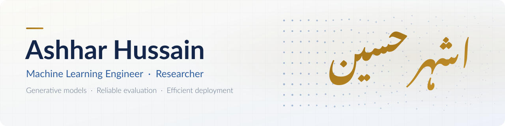

  <picture>
    <source media="(prefers-color-scheme: dark)" srcset="assets/banner-dark.svg">
    
  </picture>

  
  
  
  

I build machine-learning models and then try hard to break them. My research is about what happens after the benchmark: models that score 99% and then miss more than a third of real fires under distribution shift, INT8 compression that is lossless in-domain and lossy in the field, and evaluation protocols that can tell the difference. Lately I have been working on generative models: diffusion and flow matching from scratch, LoRA and DreamBooth on Stable Diffusion, and what fast inference really costs.

Researcher at the Department of Computer Science & IT, University of Kotli (AJ&K). The portfolio projects below ship as executed notebooks you can rerun on a free Colab runtime, the paper repositories hold the code behind J1 and J2, and the live demos open in any browser.

### Featured work

| Project | What | Key result | Stack |
|---|---|---|---|
| [**genai-diffusion-lab**](https://github.com/Ashhar-Hussain/genai-diffusion-lab) | Flow matching vs DDPM from scratch, LoRA vs full fine-tuning, DreamBooth-LoRA on SD 1.5, and what fast inference costs | DreamBooth-LoRA: rank 4 at 250 steps balances subject vs prompt fidelity in a 1.5 MB adapter; on a T4, DPM-Solver++ 15 is 9.2× faster than fp32 with no CLIP-T loss, LCM-LoRA 32.6× at a measurable cost | PyTorch · diffusers · peft · Colab T4 |
| [**rag-retrieval-ablation**](https://github.com/Ashhar-Hussain/rag-retrieval-ablation) | Retrieval scored separately from generation: BM25, dense, hybrid, re-ranking, local LLM | Re-ranking lifts Recall@1 from 0.77 to 0.89 on 1,000 questions, yet a 0.5 B local LLM gains only +0.03 F1 (not significant); misses become wrong answers, never refusals | sentence-transformers · Qwen2.5 · SQuAD |
| [**Evaluation-Code**](https://github.com/Ashhar-Hussain/Evaluation-Code) | Code for paper J1: explainable wildfire detection under distribution shift | 6 models at 97.9–99.0% in-domain all lose ~24 points on an independent dataset | TensorFlow · Grad-CAM · SHAP |
| [**TinyMWAMNet**](https://github.com/Ashhar-Hussain/TinyMWAMNet) | Code for paper J2: INT8 quantization of microcontroller-sized detectors under shift | PTQ costs ≤1 point in-domain but up to 5.8 points under shift, mostly missed fires | LiteRT · TFLM · QAT |
| [**gharchive-spark-lakehouse**](https://github.com/Ashhar-Hussain/gharchive-spark-lakehouse) | Bronze/silver/gold PySpark pipeline with data contracts and an Airflow DAG | 1.87 M events; the contract caught a real 2026 upstream change (-97.9% volume, push events gone) and held back affected tables; Parquet 25× faster than JSON | PySpark · Parquet · DuckDB · Polars |
| [**bank-marketing-decision-ml**](https://github.com/Ashhar-Hussain/bank-marketing-decision-ml) | Leakage, regime change and profit-based decisions on UCI Bank Marketing | Leak + random split inflate ROC-AUC from 0.68 to 0.95; the model chosen on rolling windows beats LightGBM on the final period (+0.063 AUC, 95% CI 0.049–0.077) | scikit-learn · LightGBM · Optuna |
| [**retail-analytics-sql**](https://github.com/Ashhar-Hussain/retail-analytics-sql) | SQL-first analytics on a million online-retail transactions | 1.07 M lines → £19.6 M clean revenue; top 20% of customers = 77% of revenue; 7-sheet Excel pack, plus a Power BI report and a [Tableau dashboard](https://public.tableau.com/app/profile/ashhar.hussain/viz/OnlineRetailSalesDashboard_17956445189300/Overview) with matching totals | DuckDB SQL · pandas · Excel · Power BI · Tableau |

### Live demos

Built for fictional businesses to show what a client gets. Each one opens in any browser with no sign-up.

| Demo | What it does | Built with |
|---|---|---|
| [**Greenleaf Clinic Assistant**](https://greenleaf-clinic-assistant.netlify.app) | Answers patient questions only from the clinic's 29 documents, shows the source under every answer and declines when no document covers the question. Correct on all 40 test questions; runs free in the browser with no API key | JavaScript · BM25 · MiniLM (transformers.js) · reciprocal rank fusion |
| [**Lead Autopilot**](https://lead-autopilot.netlify.app) | Sorts customer messages into seven types, pulls out details such as dates and budget, scores urgency and drafts a priced reply for a person to approve; the same steps as a free JSON API. Covered by 41 automated tests | JavaScript · Netlify Functions |
| [**Online Retail Sales Dashboard**](https://online-retail-sales-dashboard.netlify.app) | Revenue, orders and customers over time, cohort retention, RFM segments, top markets and product pairs from 1,003,340 cleaned order lines | DuckDB SQL · Python · SVG charts in JavaScript |
| [**Online Retail Sales on Tableau Public**](https://public.tableau.com/app/profile/ashhar.hussain/viz/OnlineRetailSalesDashboard_17956445189300/Overview) | Overview, customer and market dashboards; the matching three-page Power BI report has 23 documented DAX measures | Tableau (LOD expressions) · Power BI · DAX · Power Query |
| [**Lemon Pail Cleaning**](https://lemon-pail-cleaning.netlify.app) | Landing page with an instant price calculator, a booking form with input checks, light and dark themes and SEO markup, in one 48 KB file | HTML · CSS · JavaScript · SVG |
| [**Hue Tubes**](https://hue-tubes.netlify.app) | Installable colour-sort puzzle that works offline; a built-in solver checks every level before it is shown and powers the hints | JavaScript · Progressive Web App · service worker |

### Papers and manuscripts

- **[J1]** A. Hussain\*, A. Kabir, N. Ali, M. Y. Shabir, M. Rashid, Z. Mehmood. *Benchmark Accuracy Overstates the Performance of Explainable Wildfire Detection Models Under Distribution Shift.* Discover Artificial Intelligence (Springer Nature), revised submission in review. [code](https://github.com/Ashhar-Hussain/Evaluation-Code)
- **[J2]** A. Hussain\*. *Lossless In-Domain, Lossy under Shift: Post-Training Quantization Can Make Tiny Machine Learning Wildfire Detectors Miss Fires.* Engineering Applications of Artificial Intelligence (Elsevier), submitted. [code](https://github.com/Ashhar-Hussain/TinyMWAMNet) · [supplementary](https://github.com/Ashhar-Hussain/supplementary)
- **[M1]** A. Hussain et al. *MTL-LDL-SG: a lightweight multi-task network for tomato leaf disease classification, lesion segmentation and severity estimation.* Ready for submission (Elsevier).

### Research pilots

- [`VFU-StressTest`](https://github.com/Ashhar-Hussain/VFU-StressTest) — reproduction of an AAAI 2026 vertical federated unlearning method under party, trigger and relearning stress (PyTorch, 5 seeds)
- [`visual-security-pilot`](https://github.com/Ashhar-Hussain/visual-security-pilot) — learned U-Net attacks on perceptually encrypted images; SSIM predicts leakage (ρ = 0.91) but attacker training data matters
- [`Config-Drift-CPU-Pilot`](https://github.com/Ashhar-Hussain/Config-Drift-CPU-Pilot) — FP16/INT8/INT4 inference: 8-bit keeps accuracy but changes 4–7× more predictions under shift
- [`inference-timing-pilot`](https://github.com/Ashhar-Hussain/inference-timing-pilot) — neural-network latencies are autocorrelated, so independence-based timing analysis underestimates misses 1.5–2.5×
- [`TS-OOD-Pilot`](https://github.com/Ashhar-Hussain/TS-OOD-Pilot) — time-series OOD gains depend on the shift type; conformal coverage drops from 90% to 57% under amplitude shift
- [`shapelet-early-reliability`](https://github.com/Ashhar-Hussain/shapelet-early-reliability) — the most 'efficient' early classifier was the least reliable: −34.5 points at a new site
- [`fsoc-divergence-rl-demo`](https://github.com/Ashhar-Hussain/fsoc-divergence-rl-demo) — a Q-learning controller fails under unseen heavy rain; a simple envelope guard recovers 28 points

### How I work

- **Pre-specify, then run.** Shift axes, metrics and tests are fixed before the first result.
- **Seeds and statistics.** Multi-seed runs, paired bootstrap, McNemar with Holm correction; differences inside the noise are reported as such.
- **Negative results count.** If the new component does not help, the write-up says so.
- **Resumable by default.** Notebooks checkpoint to Drive and skip finished work after a disconnect.

### Toolbox

                  

### Activity

<picture>
  <source media="(prefers-color-scheme: dark)" srcset="https://raw.githubusercontent.com/Ashhar-Hussain/Ashhar-Hussain/output/github-snake-dark.svg">
  
</picture>
